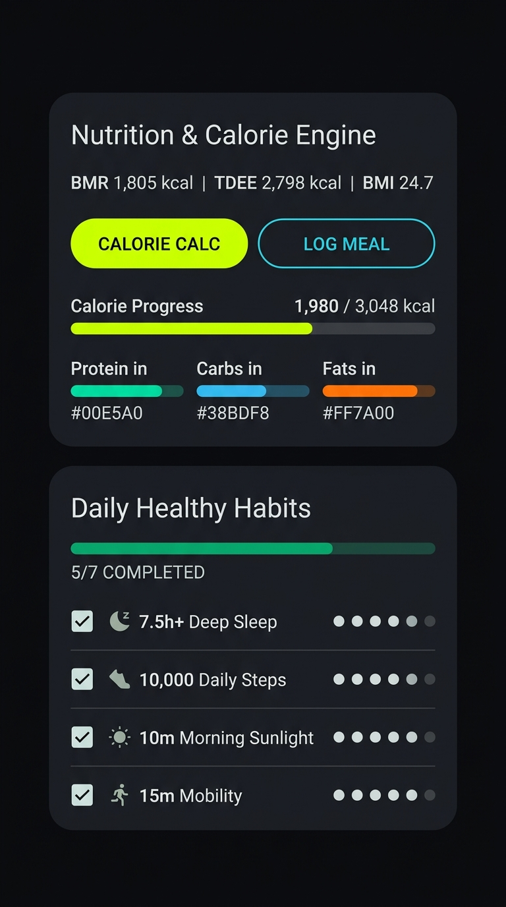
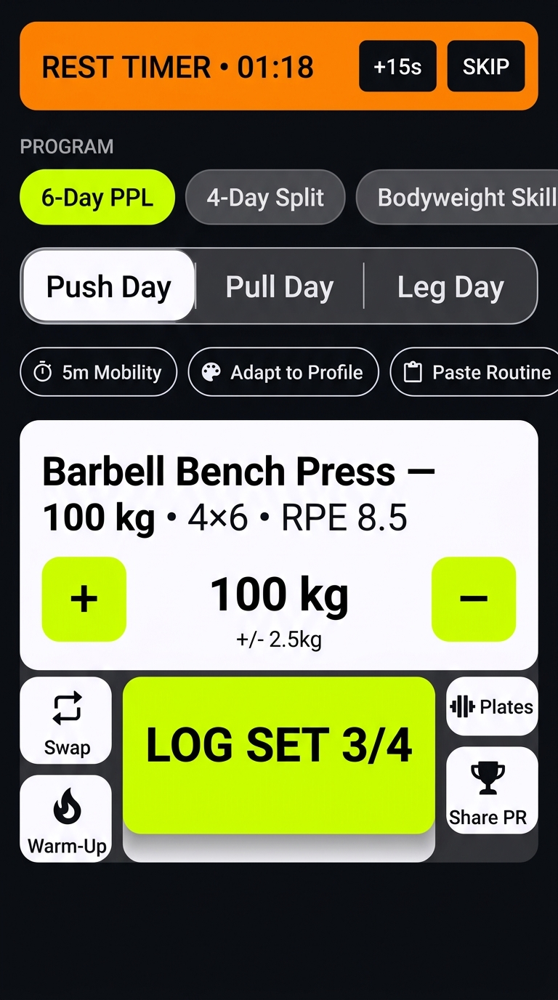
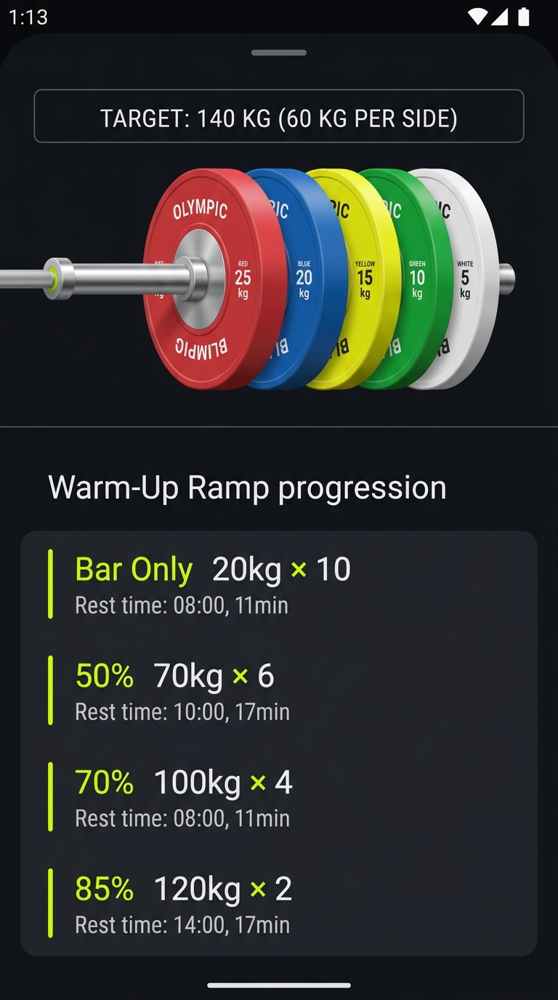
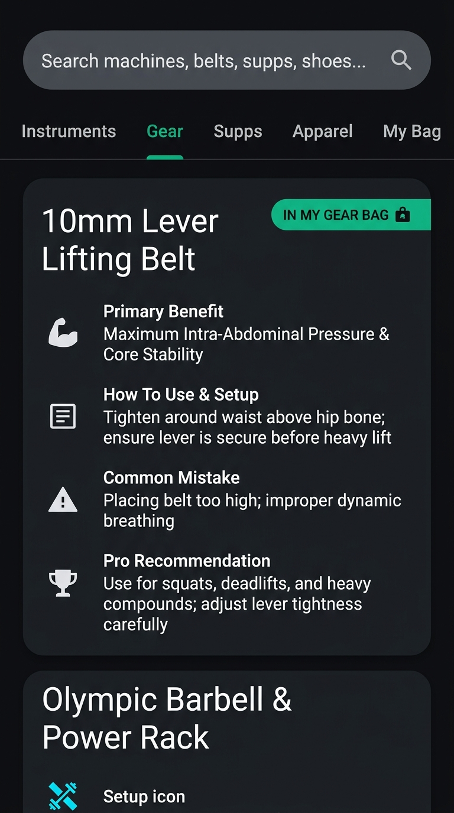
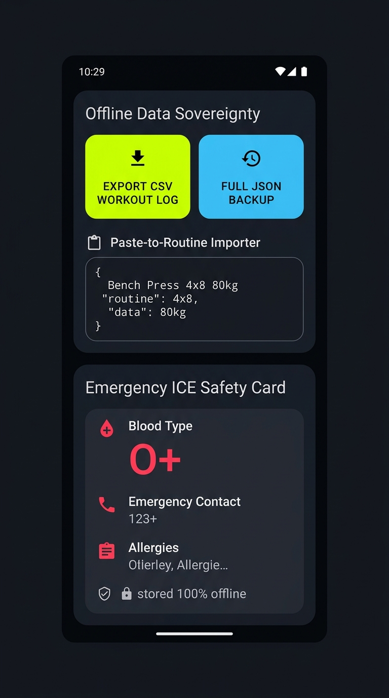

# LOCKOUT — Iron, Routine, Health & Supplement OS

> **Finish Every Rep. Master Every Metric.**  
> A 100% offline-first, commercial-grade Android performance operating system engineered with **Kotlin**, **Jetpack Compose**, **Material Design 3**, **MVVM + Coroutines/Flow**, and **Room SQLite**.

---

## Executive Overview

**LOCKOUT** unifies heavy strength training, gymnastic skill progression, interactive anatomical muscle recovery telemetry, Mifflin-St Jeor calorie & macro engineering, daily healthy body habits, date-keyed supplement dose tracking with scheduled alarms, and an encyclopedic offline Gym Vault inside a single zero-latency Android application.

Built around the **Obsidian Titanium & Kinetic Volt** design system (`#0B0D11` canvas, `#141820` layered surfaces, `#272E3D` precision hairline borders, `#C6FF00` Kinetic Volt action highlights, `#38BDF8` Glacier Cyan recovery/hydration cues, `#FF7A00` Amber Flare timers/alarms, and `#FF3B5C` Crimson Pulse alerts) with a 1-tap **Titanium Daylight** mode for bright outdoor training.

---

## Feature Showcase (10 Core Modules)

### 1. Command Center & Multi-Gym Equipment Profiles


- **Live Readiness Gauge**: Synthesizes hydration progress, daily protein intake, supplement stack compliance, healthy body habits, and muscle recovery status into a single 40–100 readiness score.
- **Multi-Gym Profile Switcher**: Instantly switch between **Commercial Gym**, **Home Barbell + DB**, **Rings & Park (Calisthenics)**, and **Hotel Dumbbells**—persisted offline in Room.
- **Instant Unit Fluidity (`KG` / `LBS`)**: 1-tap TopAppBar toggle recalculates bar weights, plate loads, smart swaps, and meet attempts globally without altering underlying precision.

---

### 2. Interactive Anatomical Muscle Recovery Map


- **Studio Anatomical Muscular System**: Replaces generic block shapes with a high-definition front anatomical diagram overlaid with precision glowing biometric telemetry nodes.
- **Direct Tap-on-Body Interaction**: Tap directly on **Chest, Shoulders, Back/Lats, Arms, Core, Quads, or Hamstrings** on the figure (or in the breakdown list) to lock the pulsing reticle onto that muscle group.
- **Biometric Inspector & Manual Override**: Inspect live recovery readiness (`100%` / `62%` / `24%`), read physiological training guidance, manually log local soreness/fatigue (`Recovered` / `Recovering` / `Fatigued`) directly to Room, or jump straight into your training session.

---

### 3. Clinical Calorie & TDEE Calculator + Daily Healthy Habits


- **Mifflin-St Jeor Metabolic Engine**: Calculates exact **BMR**, **Maintenance TDEE**, **BMI**, **Training-Day vs. Rest-Day Carb-Cycled Calories**, **Protein/Carb/Fat targets**, and **Daily Hydration** from Gender, Age, Height, Weight, Activity Level (Sedentary to Athlete 2×/day), and Nutrition Goal.
- **1-Tap Plan Sync & Custom Meal Logger**: Apply calculated targets directly to your daily nutrition dashboard, log custom meals with auto-computed kcal, or tap 1-tap staple fuel shortcuts (`+25g Whey Shake`, `+Chicken & Rice`, `+4 Eggs & Oats`).
- **Whole-Body Daily Healthy Habits**: Date-keyed Room persistence tracks 7 foundational habits (*7.5h+ Deep Sleep, 10,000 Steps, 10m Morning Sunlight, 15m Mobility, Whole-Food Clean Fuel, 3L+ Hydration, 5m Breathwork*) plus custom user habits with total days completed, active streaks, and 7-day adherence dots.

---

### 4. Gym-Floor Iron & Skill Training Logger


- **4 Built-In Science-Backed Programs**: *6-Day PPL Hypertrophy*, *4-Day Upper/Lower Powerbuilding*, *5-Day Hybrid Iron + Gymnastics/Calisthenics*, and *3-Day Full-Body Foundation*.
- **One-Handed Sweaty-Thumb Ergonomics**: Oversized `48dp+` 1-tap set completion buttons, micro-load weight steppers, Set Type badges (`WORK`, `W`, `D`, `RP`, `M`, `F`), RPE auto-overload engine, and **1-Tap Smart Exercise Swapper** when a machine is occupied.
- **Background-Safe Music-Ducking Timers**: Rest countdowns and 3-2-1-GO isometric hold timers use absolute wall-clock timestamps (`System.currentTimeMillis()`) so screen locks never cause drift, while `AUDIOFOCUS_GAIN_TRANSIENT_MAY_DUCK` gently dips Spotify/YouTube Music during chimes instead of pausing playback.

---

### 5. Visual Competition Plate Loader & Warm-Up Ramps


- **Color-Coded Olympic Plate Math**: Computes exact plates per side for 20 kg / 15 kg barbells (Red 25, Blue 20, Yellow 15, Green 10, White 5, Steel 2.5, Volt 1.25, Cyan 0.5) rendered visually on a barbell sleeve.
- **Automated Warm-Up Ramps**: Generates progressive neural priming sets (`Bar Only` → `50%` → `70%` → `85%`) with prescribed reps and rest intervals.
- **Pre-Lift 5-Min Dynamic Mobility**: Automatically matches joint prehab drills to your active training day (Push, Pull, Legs, or Skill) with 1-tap drill timers.

---

### 6. Bio-Timing Supplement OS, Days-Taken Tracker & Dose Alarms


- **Per-Supplement Days-Taken & Streak Counter**: Powered by date-keyed `SupplementLogEntity(supplementId, dateIso)` rows in Room—automatically resets daily at midnight while retaining exact **total days taken**, **active consecutive streaks**, and **7-day adherence dots** for every supplement.
- **Real Android Daily Dose Alarms**: Arm per-supplement alarms (`HH:MM AM/PM`) via `AlarmManager` + `SupplementAlarmReceiver` + high-priority `NotificationChannel` with sound, vibration, next-day auto-rescheduling, and a **Test Alarm Sound & Notification** trigger.
- **Clinical Guardrails & Inventory Forecast**: Warns about Caffeine sleep cutoffs after 3:00 PM, mineral absorption conflicts (Zinc/Calcium/Iron), and forecasts exact tub run-out dates with 1-tap Restock (+30 servings) and automatic `+500 ml` hydration boost when Creatine is in your stack.

---

### 7. Offline Gym Vault & My Gear Bag


- **Searchable Offline Knowledge Hub**: Comprehensive guides across **Gym Instruments**, **Lifting Accessories**, **Supplements**, and **Gym Apparel & Footwear**.
- **Actionable Pro Breakdown**: Every card details *Primary Benefit*, *How To Use / Setup*, *Common Mistake*, and *Pro Recommendation*.
- **Live Gear Bag Sync**: Pack items into **My Gear Bag** (e.g., 10mm Lever Belt, Knee Sleeves, Wrist Wraps, Liquid Chalk) and see real-time gear badges directly on matching exercises during workouts.

---

### 8. Performance Labs: DOTS, Wilks & Competition Meet Selector


- **Official Powerlifting Scoring**: Live **DOTS** and **Wilks** strength scores supporting Male/Female coefficients and live bodyweight updates.
- **RPG Strength Tier Ranks**: Classifies your estimated 1RM Squat, Bench, and Deadlift from *Tier I Beginner* up to *Tier V Elite* using bodyweight multipliers.
- **Meet Attempt Selector**: Auto-calculates competition **Opener (90%)**, **2nd Attempt (96%)**, and **3rd PR Attempt (102%)** for Squat, Bench Press, and Deadlift.

---

### 9. Conditioning Timer Engine & RP Mesocycle Biofeedback


- **4 Metabolic Conditioning Engines**: Background-safe **EMOM** (10 rounds), **Tabata 20/10** (8 rounds work/rest), **AMRAP** (12-minute countdown with live `+1 RND` counter), and **Zone 2 Aerobic Base** (age-derived 60–70% Max HR BPM target).
- **RP-Style Biofeedback & Auto-Deload**: Log Pump (1–3), Soreness (1–3), Joint Pain (0–3), and Average RIR (0–4) for any muscle group to dynamically add/trim working sets in Room or trigger a protective 50%-volume / 60%-load deload.

---

### 10. Offline Data Sovereignty, Routine Importer & Emergency ICE Card


- **1-Tap CSV & JSON Data Export**: Export your full workout history as CSV or your entire training, supplement, and nutrition state as structured JSON with preview, clipboard copy, and native Android Share Intent—zero cloud lock-in.
- **Paste-to-Routine Importer**: Paste plain-text workouts (e.g., `Incline Bench Press 4x8 75kg`) to parse and insert structured exercises straight into Room.
- **Emergency ICE Safety Card**: Quick-access TopAppBar modal storing emergency contact name/phone, blood type, and medical allergies 100% offline.

---

## Technical Architecture

```text
app/src/main/java/com/example/
├── MainActivity.kt                      # Edge-to-edge host, theme sync, DI wiring
├── data/
│   ├── LockoutModels.kt                 # 9 Room entities + enums + TypeConverters
│   ├── LockoutDao.kt                    # Reactive Flow DAOs for all tables
│   ├── LockoutDatabase.kt               # Room v3 SQLite singleton database
│   ├── LockoutRepository.kt             # Single source of truth + idempotent seeder
│   └── LockoutSeedData.kt               # 4 programs, stacks, 7 habits, skills, Vault
├── domain/
│   └── LockoutDomainEngine.kt           # Mifflin-St Jeor, DOTS/Wilks, 1RM, plates, streaks, biofeedback
├── engine/
│   ├── TimerEngine.kt                   # Timestamp-safe Rest, Isometric & Conditioning timers
│   ├── SupplementAlarmScheduler.kt      # Daily AlarmManager + NotificationChannel + audio ducking
│   └── SupplementAlarmReceiver.kt       # BroadcastReceiver posting dose alerts & rescheduling
├── viewmodel/
│   └── LockoutViewModel.kt              # Unidirectional StateFlow + SharedFlow snackbar events
└── ui/
    ├── theme/                           # Obsidian Titanium / Daylight palettes + bundled TTF typography
    ├── components/                      # MuscleHeatmapCard, NutritionHealthModals, ProModals, TrainingSheets
    └── screens/                         # LockoutAppShell, Dashboard, Training, Supplement, Vault, Labs
```

### Tech Stack
- **Language**: 100% Kotlin
- **UI**: Jetpack Compose + Material 3 + Adaptive `NavigationBar` / `NavigationRail` (`BoxWithConstraints`)
- **Typography**: Local bundled `Plus Jakarta Sans` + `JetBrains Mono` (tabular lining numbers)
- **Persistence**: Room SQLite (`v3`) with KSP code generation
- **Concurrency**: Kotlin Coroutines & `StateFlow` / `collectAsStateWithLifecycle`
- **Verification**: JUnit 4 + Robolectric JVM database & domain engine test suite (`gradle :app:testDebugUnitTest`)

---

## Building & Testing

```bash
# Assemble Debug APK
gradle :app:assembleDebug

# Run Unit & Robolectric Room Database Tests
gradle :app:testDebugUnitTest
```
