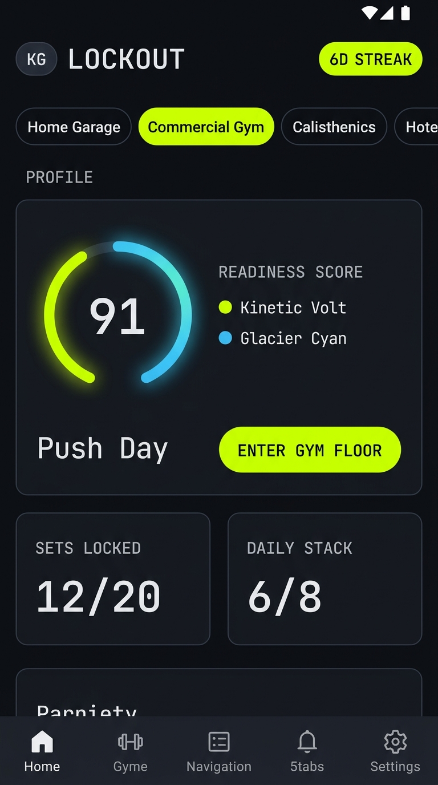
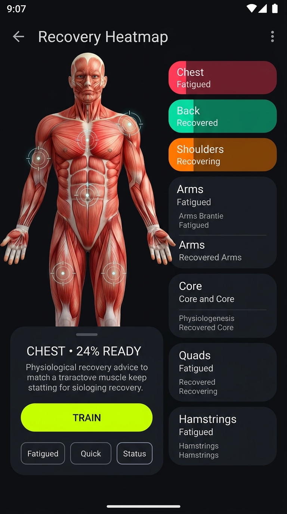
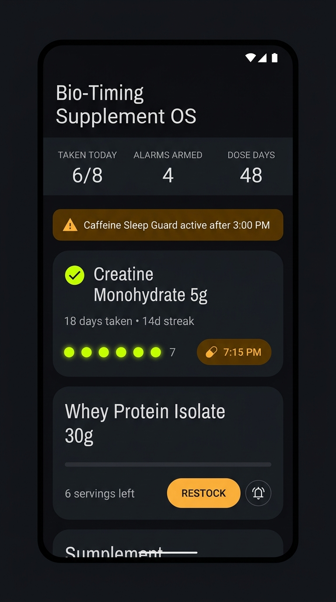
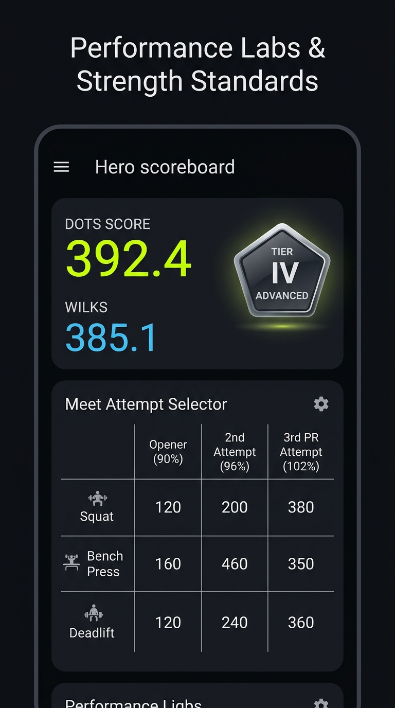
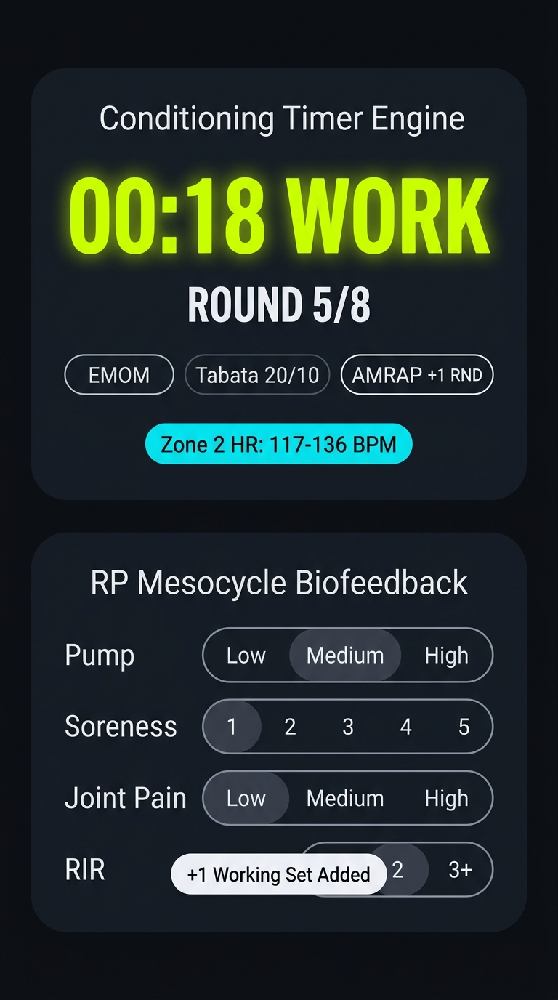

# LOCKOUT — Iron, Routine, Health & Supplement OS

> **Finish Every Rep. Master Every Metric.**  
> A 100% offline-first, commercial-grade Android performance operating system engineered with **Kotlin**, **Jetpack Compose**, **Material Design 3**, **MVVM + Coroutines/Flow**, and **Room SQLite (v3)**.

---

## Executive Overview

**LOCKOUT** combines heavy barbell & calisthenics training, an interactive real-anatomy muscle recovery map, a Mifflin-St Jeor calorie & TDEE engine, a whole-body daily healthy habits tracker, a date-keyed supplement stack with real Android daily dose alarms, a competition barbell plate loader with integrated warm-up ramps, and an offline Gym Vault with studio product photography across every core screen.

Crafted with the **Obsidian Titanium & Kinetic Volt** design system (`#0B0D11` deep obsidian canvas, `#141820` layered cards, `#272E3D` hairline borders, `#C6FF00` Kinetic Volt action accents, `#38BDF8` Glacier Cyan hydration/recovery accents, `#FF7A00` Amber Flare timers/alarms, and `#FF3B5C` Crimson Pulse alerts) plus a 1-tap **Titanium Daylight** high-contrast theme for outdoor training.

---

## Complete Feature Showcase (10 Illustrated Modules)

### 1. Command Center & Multi-Gym Equipment Profiles


- **Live Readiness Gauge (40–100)**: Continuously computes athlete readiness from daily hydration, protein intake, supplement compliance, daily healthy habits, and muscle recovery status.
- **Multi-Gym Profile Switcher**: Switch instantly between **Commercial Gym**, **Home Barbell + DB**, **Rings & Park (Calisthenics)**, and **Hotel Dumbbells**—persisted offline in Room to drive profile-aware exercise swaps.
- **Global Unit Fluidity (`KG` / `LBS`)**: A single tap in the TopAppBar dynamically converts working loads, plate breakdowns, warm-up ramps, smart swaps, and powerlifting meet attempts across the entire app.
- **Live Session Launch & KPIs**: Resume active sessions in one tap, monitor locked sets and daily stack progress, and see automatic low-stock supplement tub alerts.

---

### 2. Interactive Real-Anatomy Muscle Recovery Map


- **Studio Anatomical Muscular System**: Uses a crisp, high-definition front anatomical muscular illustration inside a dark telemetry viewport with subtle glowing status nodes that preserve full muscle striation detail.
- **Direct Tap-on-Body Interaction**: Tap directly on **Chest, Shoulders, Back/Lats, Arms, Core, Quads, or Hamstrings** on the anatomical figure—or tap any row in the recovery breakdown—to lock the pulsing target reticle onto that muscle group.
- **Biometric Inspector & Manual Soreness Override**: View exact readiness (`100%` Recovered / `62%` Recovering / `24%` Fatigued), read tailored physiological guidance, log your real-world muscle feeling directly to Room, or tap **TRAIN** to jump straight into your workout.

---

### 3. Clinical Calorie & TDEE Calculator + Daily Healthy Habits


- **Mifflin-St Jeor Metabolic Engine**: Calculates **BMR**, **Maintenance TDEE**, **BMI & Category**, **Training-Day vs. Rest-Day Carb-Cycled Calories**, **Protein/Carb/Fat targets**, and **Daily Hydration (ml)** based on Gender, Age, Height, Bodyweight, Activity Level (*Sedentary 1.2×* to *Athlete 2×/day 1.9×*), and Nutrition Goal (*Lean Bulk, Body Recomp, Maintain, Fat Loss Cut*).
- **1-Tap Target Sync & Custom Meal Logger**: Apply calculated calorie & macro targets straight to your live daily tracker, log any custom meal with auto-computed calories, or tap 1-tap staple fuel buttons (`+25g Whey Shake`, `+Chicken & Rice`, `+4 Eggs & Oats`).
- **Whole-Body Daily Healthy Habits OS**: Tracks 7 foundational body habits (*7.5h+ Deep Sleep, 10,000 Daily Steps, 10m Morning Sunlight, 15m Mobility & Posture, Whole-Food Clean Fuel, 3L+ Water & Electrolytes, 5m Breathwork*) plus custom user habits with date-keyed midnight resets, total days logged, streaks, and 7-day adherence dots.

---

### 4. Gym-Floor Iron & Skill Training Logger


- **Photorealistic Gym Floor Header**: Opens with a studio-lit knurled dumbbell & iron plate hero banner showing live program, training day, and locked sets counter.
- **4 Science-Backed Programs Included**: *6-Day PPL Hypertrophy*, *4-Day Upper/Lower Powerbuilding*, *5-Day Hybrid Iron + Gymnastics/Calisthenics*, and *3-Day Full-Body Foundation*.
- **Sweaty-Thumb Gym Ergonomics**: Oversized `48dp+` 1-tap set completion buttons, micro-load weight steppers, Set Type cycling (`WORK`, `W`, `D`, `RP`, `M`, `F`), **RPE Auto-Progressive Overload**, **1-Tap Smart Equipment Swapper**, **Gymnastics Skill Tree**, and **Joint/Injury Guardrails**.
- **Background-Safe Music-Ducking Timers**: Rest countdowns and 3-2-1-GO isometric hold timers compute remaining time from absolute wall-clock timestamps (`System.currentTimeMillis()`) so screen locks never drift, while `AUDIOFOCUS_GAIN_TRANSIENT_MAY_DUCK` dips music gently without pausing Spotify or YouTube Music.

---

### 5. Visual Competition Barbell Plate Loader & Warm-Up Ramps


- **Photorealistic Olympic Barbell Header + Live Sleeve Visualizer**: Pairs a photorealistic 3D studio Olympic barbell & competition bumper plate showcase with a live dynamic metallic barbell sleeve computing exact plates per side (Red 25, Blue 20, Yellow 15, Green 10, White 5, Steel 2.5, Volt 1.25, Cyan 0.5) for 20 kg or 15 kg bars.
- **Integrated Warm-Up Ramp Progression**: Displays progressive neural priming steps (`Bar Only` → `50%` → `70%` → `85%`) with exact weights, reps, purpose, and rest periods right inside the Plate Loader modal.
- **Pre-Lift 5-Min Dynamic Mobility**: Automatically matches joint prehab drills to the active training day (Push, Pull, Legs, or Skill) with 1-tap timers.

---

### 6. Bio-Timing Supplement OS, Days-Taken Tracker & Dose Alarms


- **Photorealistic Supplement Lab Header & Compliance KPIs**: Displays live counts for *Taken Today*, *Alarms Armed*, and *Total Dose Days* logged across your stack.
- **Per-Supplement Days-Taken & Streak Counter**: Powered by date-keyed `SupplementLogEntity(supplementId, dateIso)` rows in Room—automatically resets every midnight while tracking exact **total days taken**, **active consecutive streak**, and a **7-day visual adherence dot timeline** for every supplement.
- **Real Android Daily Dose Alarms**: Configure an exact daily alarm time (`HH:MM AM/PM`) per supplement via `AlarmManager` + `SupplementAlarmReceiver` + high-priority `NotificationChannel` with sound, vibration, automatic next-day rescheduling, and a **Test Alarm Sound & Notification** button.
- **Clinical Guardrails & Inventory Forecast**: Flags Caffeine sleep cutoffs after 3:00 PM, mineral absorption conflicts (Zinc/Calcium/Iron), tub run-out dates with 1-tap Restock (+30 servings), and automatic `+500 ml` hydration boost for Creatine users.

---

### 7. Offline Gym Vault & My Smart Gear Bag


- **Photorealistic Powerlifting Gear Studio Banner**: Showcases a leather lever belt, knee sleeves, wrist wraps, barbell collars, and flat lifting shoes above an instant offline search bar.
- **4 Encyclopedic Categories**: Searchable offline pro guides for **Gym Instruments**, **Lifting Accessories**, **Supplements**, and **Gym Apparel & Footwear**, each detailing *30-Second Setup*, *Common Mistake Fixed*, and *Pro Rule*.
- **Smart Gear Bag Sync**: Toggle owned gear into **My Gear Bag** and see automatic packed-gear badges on heavy compound sets in Training, or import any Vault supplement straight into your daily stack.

---

### 8. Performance Labs: DOTS, Wilks & Competition Meet Selector


- **Official Powerlifting Telemetry**: Real-time **DOTS** and **Wilks** score calculators supporting Male/Female polynomial coefficients and live athlete bodyweight.
- **RPG Strength Tier Ranks**: Automatically classifies Squat, Bench Press, and Deadlift estimated 1RMs from *Tier I Beginner* through *Tier V Elite* using bodyweight multipliers.
- **Competition Meet Attempt Selector**: Computes exact competition **Opener (90%)**, **2nd Attempt (96%)**, and **3rd PR Attempt (102%)** for Squat, Bench, and Deadlift in your preferred unit (`KG` or `LBS`).

---

### 9. Conditioning Timer Engine & RP Mesocycle Biofeedback


- **4 Metabolic Conditioning Timers**: Background-safe **EMOM** (10 rounds), **Tabata 20/10** (8 rounds work/rest), **AMRAP** (12-min countdown with live `+1 RND` counter), and **Zone 2 Aerobic Base** (age-based 60–70% Max HR BPM zone) with music-ducking audio cues.
- **RP-Style Mesocycle Auto-Regulation**: Submit per-muscle Pump (1–3), Soreness (1–3), Joint Pain (0–3), and Average RIR (0–4) check-ins to automatically scale weekly working sets in Room or trigger a protective 50%-volume / 60%-load Deload.

---

### 10. Offline Data Sovereignty, Routine Importer & Emergency ICE Card


- **1-Tap CSV & JSON Data Export**: Export your entire workout log as CSV or your complete training, supplement, and nutrition state as structured JSON with live preview, clipboard copy, and native Android Share Intent.
- **Paste-to-Routine Importer**: Paste plain-text training plans (e.g., `Incline Bench Press 4x8 75kg`) to parse sets, reps, load, and primary muscle group directly into Room.
- **Emergency ICE Medical Safety Card**: TopAppBar quick-access modal storing emergency contact name, phone number, blood type, and medical allergies 100% offline.

---

## Architecture & Tech Stack

```text
app/src/main/java/com/example/
├── MainActivity.kt                      # Edge-to-edge host, theme sync, DI setup
├── data/
│   ├── LockoutModels.kt                 # 9 Room entities + enums + TypeConverters
│   ├── LockoutDao.kt                    # Reactive Flow DAOs for workouts, supps, habits, vault
│   ├── LockoutDatabase.kt               # Room v3 SQLite database singleton
│   ├── LockoutRepository.kt             # Single source of truth + idempotent first-run seeder
│   └── LockoutSeedData.kt               # 4 programs, stacks, 7 habits, skill trees, Gym Vault
├── domain/
│   └── LockoutDomainEngine.kt           # Mifflin-St Jeor, DOTS/Wilks, 1RM, plates, streaks, biofeedback
├── engine/
│   ├── TimerEngine.kt                   # Timestamp-safe Rest, Isometric & Conditioning timers
│   ├── SupplementAlarmScheduler.kt      # Daily AlarmManager + NotificationChannel + audio ducking
│   └── SupplementAlarmReceiver.kt       # BroadcastReceiver posting dose alerts & next-day reschedule
├── viewmodel/
│   └── LockoutViewModel.kt              # Unidirectional StateFlow + SharedFlow snackbar events
└── ui/
    ├── theme/                           # Obsidian Titanium / Daylight palettes + bundled TTF fonts
    ├── components/                      # MuscleHeatmapCard, NutritionHealthModals, ProModals, TrainingSheets
    └── screens/                         # LockoutAppShell, Dashboard, Training, Supplement, Vault, Labs
```

- **Language & UI**: 100% Kotlin, Jetpack Compose, Material Design 3, adaptive `NavigationBar` / `NavigationRail`
- **Typography**: Local bundled `Plus Jakarta Sans` + `JetBrains Mono` (tabular lining numbers)
- **Visual Assets**: Studio-rendered anatomical muscle map, 3D Olympic barbell & bumper plates, knurled hex dumbbells, powerlifting gear flat-lay, and minimalist supplement lab hero banners
- **Persistence**: Room SQLite (`v3`) with KSP code generation
- **Testing**: JUnit 4 domain engine unit tests + Robolectric Room database tests

---

## Building & Running Tests

```bash
# Assemble Debug APK
gradle :app:assembleDebug

# Run Domain Engine Unit Tests
gradle :app:testDebugUnitTest --tests "com.example.ExampleUnitTest"
```

---

## License

This project is licensed under the **MIT License** — see the [LICENSE](LICENSE) file for details.

